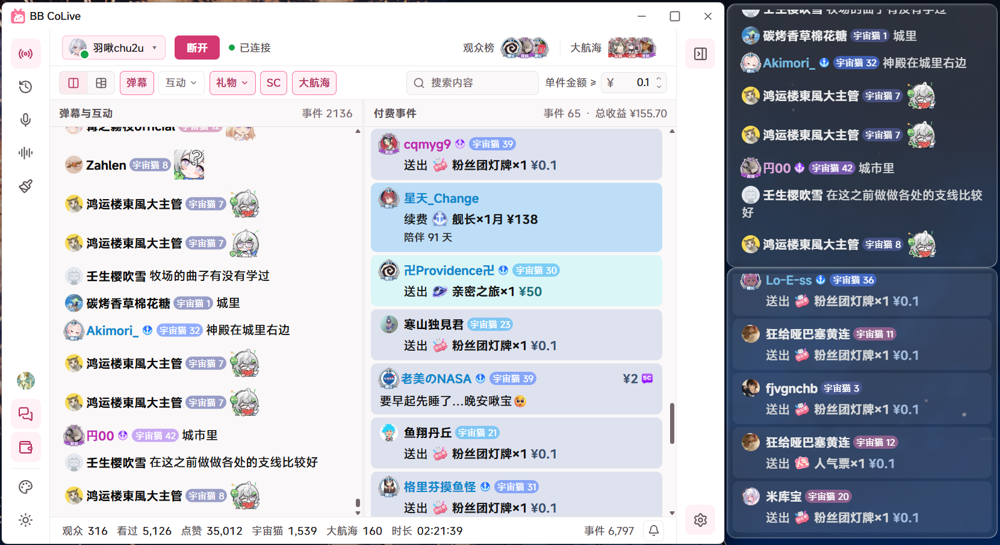
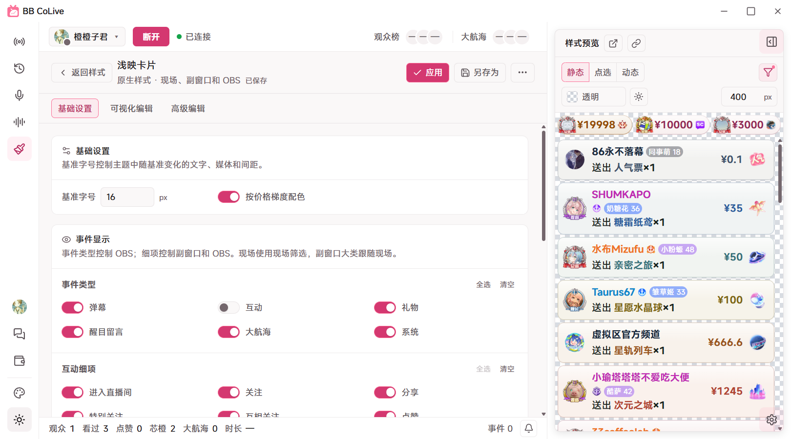

<div align="center">


# BB CoLive

[简体中文](README.md) · [繁體中文](README.zh-Hant.md) · [English](README.en.md) · [日本語](README.ja.md)

**Your smart streaming companion.**

A Windows desktop tool for Bilibili Live featuring Danmaku display, TTS readout, theme customization, and local stream history.

<a href="https://github.com/OrangeChange/bb-colive/releases/tag/v1.2.0"><picture><source media="(prefers-color-scheme: dark)" srcset="docs/images/badges/github-version-dark.svg" /></picture></a>
<a href="https://gitee.com/orange-chan/bb-colive/releases/tag/v1.2.0"><picture><source media="(prefers-color-scheme: dark)" srcset="docs/images/badges/gitee-version-dark.svg" /></picture></a>
<picture><source media="(prefers-color-scheme: dark)" srcset="docs/images/badges/windows-dark.svg" /></picture>
<a href="LICENSE"><picture><source media="(prefers-color-scheme: dark)" srcset="docs/images/badges/license-dark.svg" /></picture></a>

[Features](#features) · [Screenshots](#screenshots) · [Quick Start](#quick-start) · [Documentation](#documentation) · [Development & Build](#development--build)

</div>

> Download badges point to the released v1.2.0 build. This README describes the `main` branch; see [Project Status](docs/project-status.md) for unreleased changes.

## Features

Everything from live Danmaku monitoring and standalone overlay windows to voice readout and post-stream history review in one desktop app.

| Feature | What it does |
| --- | --- |
| **Live** | View Danmaku, interactions, gifts, Super Chats, Membership events, and system messages; filter by category and amount, and inspect room overview, viewer rankings, and Membership rankings. |
| **Secondary windows** | Open the Danmaku window and Revenue window; the Revenue window can be split into Gifts, Super Chat, and Membership windows with always-on-top, lock, and click-through support. |
| **OBS output** | Save Browser Source profiles per room with independent themes, display scale, and light/dark appearance to overlay events on your stream. |
| **Style editor** | Use three built-in native themes or choose BLC Original, BLC Open, or LAPLACE compatible styles; supports visual editing, custom CSS, theme import/export, and live preview. |
| **Voice & effects** | Read events aloud with TTS, configure local alert sounds for Custom audio, and toggle Gift or Membership effects as needed. |
| **Stream history** | Browse local archives by streamer and session, search events, favorite items with notes and tags, and export to Excel, CSV, or JSON. |
| **Interface language** | Supports Simplified Chinese, Traditional Chinese, English, and Japanese, with multilingual settings search; stream event content remains untranslated. |

### Tailor the look to your stream

- **Three native themes**: 原生默认 (Native Default), 浅映卡片 (Soft Light), and 轻语气泡 (Soft Whisper).
- **Visual customization**: Edit typography, identity badges, price tiers, and gradients; configure image backgrounds, decorations, image borders, and avatar frames with part-level and event-level previews, or write CSS directly.
- **Per-output themes**: Use different themes for Live, secondary windows, and OBS; secondary windows can share one theme or use separate ones.
- **Always-on preview**: Static, inspect, and dynamic previews share the app's actual rendering components; Stream history appearance is configured independently.
- **App palettes**: Sakura, Celadon, and custom palettes with Light, Dark, and System theme modes.

### Review past streams anytime

Stream history archives are stored locally and organized by streamer and session. Search for specific Danmaku messages, a user's interactions or gift records, and organize favorites with notes and tags.

To recover historical records from your own cloud collection server, configure BB EventFetcher and restore by scope into your local archive. The client and collector run independently—see [Cloud record recovery](docs/user-guide.md#恢复云端记录) for setup details.

## Screenshots



Live view and secondary windows mode



Built-in native styles with a full editor window and visual customization

## Quick Start

### Monitor a stream & open secondary windows

1. Launch BB CoLive and scan the QR code with the Bilibili app to log in.
2. Add a streamer or enter a room ID, then click **Connect**.
3. Toggle Danmaku, interactions, and paid events in **Live** as needed; open the **Danmaku window** and **Revenue window** from the sidebar.
4. Go to **Styles → Active** to choose themes for Live and secondary windows; click **Apply** after editing to update outputs.
5. Recorded streams can be browsed anytime under **Stream history** by streamer and session.

### Add to OBS

1. Go to **Styles → OBS settings** and create a new profile.
2. Select a room, theme, display scale, and appearance mode, then save the profile.
3. Copy the **OBS URL**, add a **Browser Source** in OBS, and paste the URL.

OBS output is served locally by the app, so keep BB CoLive running while streaming. See [Browser output](docs/user-guide.md#添加到-obs) for details.

### Enable voice readout

On the **Voice** page, pick an engine, choose a voice, test it, and enable voice readout. Supports Edge Online, Windows System voices, Fish Audio, and Custom HTTP API; local alert sounds are configured under **Custom audio**.

Manage playback destination and audio output devices under **Settings → Voice & alerts → Audio output**. See [Voice \& Custom audio](docs/user-guide.md#语音与个性播报) for details.

## Documentation

| Topic | Guide |
| --- | --- |
| Switching languages & searching settings | [Interface Language \& Settings Search](docs/user-guide.md#界面语言与设置搜索) |
| Login, connecting & reconnecting | [Connecting \& Login](docs/user-guide.md#连接直播间) |
| Filtering, merging & event actions | [Live Event Feed](docs/user-guide.md#查看现场) |
| Opening, splitting & adjusting secondary windows | [Danmaku \& Revenue Windows](docs/user-guide.md#开启副窗口) |
| Editing themes, images & CSS | [Styles \& Visual Editor](docs/user-guide.md#修改样式) |
| Identity badges & price display | [Event Display](docs/user-guide.md#编辑主题) |
| Searching history & organizing favorites | [Stream History \& Archives](docs/user-guide.md#回看与收藏) · [Favorites](docs/user-guide.md#回看与收藏) |
| Exporting records & revenue data | [Data Export](docs/user-guide.md#备份与导出) |
| Troubleshooting connection, audio, or display | [Diagnostics \& Logs](docs/user-guide.md#如何反馈问题) |

[Full User Guide](docs/user-guide.md) · [Developer Documentation](docs/README.md)

## FAQ

### Which platforms are supported?

Currently **Windows 10 / 11 x64** (with WebView2) is officially supported. macOS and Linux are not supported. Both installer and portable builds support in-app updates with China Mainland and Global download routes.

### Where are data and custom themes stored?

| Data | Installer | Portable |
| --- | --- | --- |
| Settings, login session, archives & logs | `%APPDATA%\BB CoLive\` | `data/` next to the executable |
| Themes & custom assets | `style/` next to the executable | `style/` next to the executable |

Portable mode is enabled by placing `portable.flag` next to the executable. When moving or backing up the portable build, keep the entire folder including `data/` and `style/`.

Before upgrading from legacy `danmu-app` to v1.0.0, close the old app and back up your data. On first launch, legacy data is copied without deleting the original folder, and existing target data will not be overwritten. See [Preserving records on upgrade](docs/user-guide.md#升级时怎么保留记录).

### Does hiding events affect saved records?

Live filters and archive recording are independent—hiding events does not delete raw records. Stream history uses its own filters and appearance settings and does not change with Live themes.

### How do I share troubleshooting info?

Export a 24h or full diagnostic bundle under **Settings → Diagnostics & logs**. Diagnostic bundles are for troubleshooting; use Archive Transfer or Data Export for backups and data analysis. See [Diagnostics \& Logs](docs/user-guide.md#如何反馈问题).

## Development & Build

Built with **Tauri 2 · React 19 · TypeScript · Tailwind CSS · shadcn/ui · Radix UI**.

Prerequisites: Windows 10 / 11 x64, Node.js 24, Rust MSVC toolchain, Microsoft C++ Build Tools, and WebView2; ensure `~/.cargo/bin` is in `PATH`.

```bash
npm ci
npm ci --prefix vendor/blivechat

npm run tauri dev                      # Start dev environment
npm run build                          # TypeScript check & frontend build
npm test                               # Run Node tests
npm run tauri -- build --bundles nsis   # Build Windows installer
```

The second `npm ci` installs dependencies for compatibility rendering and full test runs. Browser tests use Playwright with local Edge or Chrome. Use a release build for daily stream recording so dev hot-reloading does not interrupt live state.

- [Developer Docs](docs/README.md): Feature conventions, architecture, and maintenance notes.
- [Debugging \& Testing](docs/development/debugging-and-testing.md): Dev entry points, runtime constraints, and verification.
- [UI Components](src/components/shadcn/README.md): shadcn/ui integration, shared controls, and styling responsibilities.
- [Interface Localization](docs/development/interface-localization.md): Translation boundaries, terminology, and QA requirements.
- [Build \& Release](docs/development/build-and-release.md): Installer, portable, and source packages.
- [Architecture](docs/architecture.md) · [Repository Structure](docs/development/repository-structure.md).
- [Product \& UI Specs](docs/specifications/README.md) · [Native Event Style Contract](docs/development/native-event-style-contract.md).

## Author & Related Projects

<p>
<picture><source media="(prefers-color-scheme: dark)" srcset="docs/images/badges/compatible-label-dark.png" /></picture>
<a href="https://github.com/xfgryujk/blivechat"><picture><source media="(prefers-color-scheme: dark)" srcset="docs/images/badges/blivechat-dark.png" /></picture></a>
<a href="https://chat.laplace.live/"><picture><source media="(prefers-color-scheme: dark)" srcset="docs/images/badges/laplace-dark.png" /></picture></a>
</p>

<p>
<a href="https://react.dev/"><picture><source media="(prefers-color-scheme: dark)" srcset="docs/images/badges/react-dark.png" /></picture></a>
<a href="https://tauri.app/"><picture><source media="(prefers-color-scheme: dark)" srcset="docs/images/badges/tauri-dark.png" /></picture></a>
<a href="https://tailwindcss.com/"><picture><source media="(prefers-color-scheme: dark)" srcset="docs/images/badges/tailwind-dark.png" /></picture></a>
<a href="https://ui.shadcn.com/"><picture><source media="(prefers-color-scheme: dark)" srcset="docs/images/badges/shadcn-dark.svg" /></picture></a>
<a href="https://www.radix-ui.com/"><picture><source media="(prefers-color-scheme: dark)" srcset="docs/images/badges/radix-dark.png" /></picture></a>
</p>

<p>
<a href="https://space.bilibili.com/4261481"><picture><source media="(prefers-color-scheme: dark)" srcset="docs/images/badges/bilibili-dark.png" /></picture></a>
<a href="https://afdian.com/a/orangeee"><picture><source media="(prefers-color-scheme: dark)" srcset="docs/images/badges/afdian-dark.png" /></picture></a>
</p>

## License

First-party code in this repository is licensed under the [BB CoLive Software \& Source License](LICENSE), a **source-available license** (not an OSI-approved open-source license).

Streamers and companies may use the software for commercial activities, and themes or related services may be offered for a fee. Unauthorized commercial resale of the original software, modified versions, or usage rights is prohibited. See the license text for full terms.

Third-party dependencies, fonts, compatible themes, and assets are governed by their respective licenses; see [Third-Party Notices](THIRD_PARTY_NOTICES.md). Complete offline license notices are bundled with both installer and portable releases.

© 2026 橙橙子君 Orange
