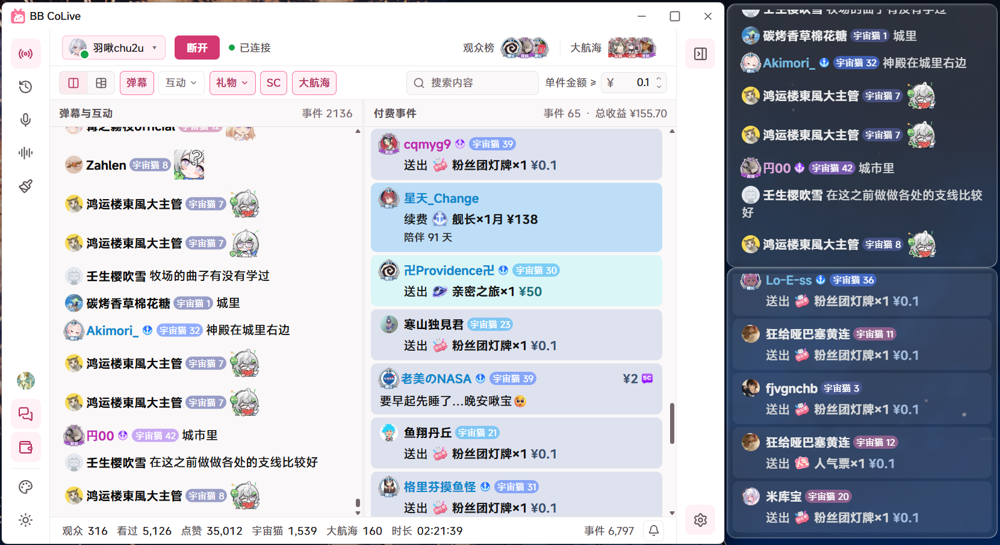
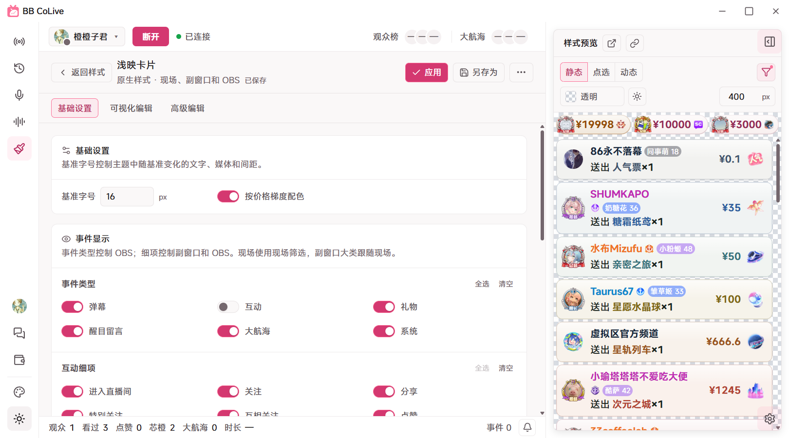

<div align="center">


# BB CoLive

[简体中文](README.md) · [繁體中文](README.zh-Hant.md) · [English](README.en.md) · [日本語](README.ja.md)

**配信に寄り添うパートナー。**

Bilibili ライブ向けの弾幕表示・音声読み上げ・スタイルカスタマイズ・配信履歴管理ツール。

<a href="https://github.com/OrangeChange/bb-colive/releases/tag/v1.2.0"><picture><source media="(prefers-color-scheme: dark)" srcset="docs/images/badges/github-version-dark.svg" /></picture></a>
<a href="https://gitee.com/orange-chan/bb-colive/releases/tag/v1.2.0"><picture><source media="(prefers-color-scheme: dark)" srcset="docs/images/badges/gitee-version-dark.svg" /></picture></a>
<picture><source media="(prefers-color-scheme: dark)" srcset="docs/images/badges/windows-dark.svg" /></picture>
<a href="LICENSE"><picture><source media="(prefers-color-scheme: dark)" srcset="docs/images/badges/license-dark.svg" /></picture></a>

[主な機能](#主な機能) · [画面プレビュー](#画面プレビュー) · [クイックスタート](#クイックスタート) · [ドキュメント](#ドキュメント) · [開発とビルド](#開発とビルド)

</div>

> ダウンロードバッジはリリース済みの v1.2.0 を指しています。本ページは現在の `main` ブランチに基づく説明です。インストーラー未収録の更新については[プロジェクト状況](docs/project-status.md)をご覧ください。

## 主な機能

配信中の弾幕閲覧からサブウィンドウ表示、音声読み上げ、配信後の履歴確認までを1つのツールで完結できます。

| 機能 | できること |
| --- | --- |
| **ライブ** | 弾幕・インタラクション・ギフト・Super Chat・大航海・システムメッセージを表示。種別や金額での絞り込み、ルーム概要・視聴者ランキング・大航海ランキングの確認に対応。 |
| **サブウィンドウ** | 弾幕ウィンドウと収益ウィンドウを表示。収益ウィンドウはギフト・Super Chat・大航海の3つに分割でき、最前面表示・ロック・マウス操作透過に対応。 |
| **OBS 表示** | ルームごとにブラウザソース設定を保存し、テーマ・表示スケール・明暗モードを個別に設定して配信画面へ出力。 |
| **スタイル編集** | 3種類のネイティブテーマに加え、BLC オリジナル版・BLC オープン版・LAPLACE 互換スタイルに対応。ビジュアル編集、CSS 編集、テーマのインポート／エクスポート、リアルタイムプレビューが可能。 |
| **音声とエフェクト** | TTS によるイベント読み上げ、カスタム音声用のローカル通知音設定、ギフト・大航海エフェクトのオン／オフに対応。 |
| **配信履歴と整理** | 配信者・配信回ごとにローカルアーカイブを閲覧。イベント検索、メモやタグ付きのお気に入り登録、Excel・CSV・JSON へのエクスポートが可能。 |
| **表示言語** | 簡体字中国語・繁体字中国語・英語・日本語に対応し、設定検索も4言語のキーワードに対応（イベント本文は翻訳せず原文のまま表示）。 |

### 配信に合わせて見た目をカスタマイズ

- **3種類のネイティブテーマ**：原生默认（標準）、浅映卡片（Soft Light）、轻语气泡（Soft Whisper）。
- **ビジュアル編集**：文字・属性バッジ・価格グラデーションを調整可能。背景画像・装飾画像・画像枠線・アバターフレームを個別に設定でき、パーツ単位・イベント単位のプレビューや CSS 直接編集にも対応。
- **出力先ごとの個別設定**：ライブ画面・サブウィンドウ・OBS で異なるテーマを使用可能。サブウィンドウは共通テーマまたは個別設定を選択できます。
- **リアルタイムプレビュー**：静的・選択・動的プレビューはアプリ本体の描画コンポーネントを共有。配信履歴の外観は独立して設定できます。
- **アプリ配色**：桜色、青磁色、カスタム配色に対応し、ライト・ダーク・システム連動を切り替え可能。

### 配信後もいつでも振り返り

配信履歴アーカイブはローカルに保存され、配信者および配信回ごとに整理されます。特定の弾幕や視聴者のインタラクション・ギフト履歴を検索したり、お気に入り・メモ・タグで整理したりできます。

自身のクラウド記録サーバーから履歴を取得する場合は、BB EventFetcher を設定して指定範囲をローカルアーカイブへ復元できます。クライアントと収集サービスは独立して動作します。詳しくは[クラウド記録の復元](docs/user-guide.md#恢复云端记录)をご覧ください。

## 画面プレビュー



ライブ画面とサブウィンドウモード



充実した編集ウィンドウとビジュアルカスタマイズ機能を備えた内蔵ネイティブスタイル

## クイックスタート

### 配信の閲覧とサブウィンドウの起動

1. BB CoLive を起動し、案内に従って Bilibili アプリで QR コードログインします。
2. 配信者を追加するかルーム ID を入力し、**接続** をクリックします。
3. ライブ画面で必要に応じて弾幕・インタラクション・有料イベントを表示し、サイドバーから **弾幕ウィンドウ** と **収益ウィンドウ** を開きます。
4. **スタイル → 現在使用中** からライブ画面とサブウィンドウのテーマを選択し、編集後は **適用** をクリックして出力を更新します。
5. 記録された配信は **配信履歴** から配信者・配信回ごとに閲覧できます。

### OBS への追加

1. **スタイル → OBS 設定** から新しいプロファイルを作成します。
2. ルーム・テーマ・表示スケール・明暗モードを選択して保存します。
3. **OBS URL** をコピーし、OBS で **ブラウザソース** を追加して URL を貼り付けます。

OBS 出力はローカルアプリから配信されるため、使用中は BB CoLive を起動したままにしてください。詳細は[ブラウザ出力](docs/user-guide.md#添加到-obs)をご覧ください。

### 音声読み上げの有効化

**音声** ページでエンジンを選択し、ボイスを設定してテスト再生したうえで読み上げを有効にします。Edge オンライン、Windows システム音声、Fish Audio、カスタム HTTP API に対応しており、ローカル通知音は **カスタム音声** で設定できます。

音声の出力先とオーディオデバイスは **設定 → 音声と通知 → 音声出力** で一括管理できます。詳細は[音声とカスタム音声](docs/user-guide.md#语音与个性播报)をご覧ください。

## ドキュメント

| 知りたい内容 | ドキュメント |
| --- | --- |
| 言語切り替えと設定検索 | [表示言語と設定検索](docs/user-guide.md#界面语言与设置搜索) |
| ログイン・接続・再接続 | [接続とログイン](docs/user-guide.md#连接直播间) |
| 絞り込み・統合・イベント操作 | [ライブイベント一覧](docs/user-guide.md#查看现场) |
| サブウィンドウの起動・分割・調整 | [弾幕ウィンドウと収益ウィンドウ](docs/user-guide.md#开启副窗口) |
| テーマ・画像・CSS の編集 | [スタイルとビジュアル編集](docs/user-guide.md#修改样式) |
| 属性バッジと金額表示 | [イベント表示](docs/user-guide.md#编辑主题) |
| 配信履歴の検索とお気に入り整理 | [配信履歴とアーカイブ](docs/user-guide.md#回看与收藏) · [お気に入り](docs/user-guide.md#回看与收藏) |
| 記録と収益データのエクスポート | [データエクスポート](docs/user-guide.md#备份与导出) |
| 接続・音声・表示トラブルの切り分け | [診断とログ](docs/user-guide.md#如何反馈问题) |

[ユーザーガイド全文](docs/user-guide.md) · [開発・メンテナンスドキュメント](docs/README.md)

## よくある質問

### 対応 OS は？

現在は **Windows 10 / 11 x64**（WebView2 必須）を正式サポートしています。macOS・Linux には対応していません。インストーラー版・ポータブル版ともにアプリ内アップデートに対応しており、中国国内／海外のダウンロード回線を選択できます。

### データやカスタムテーマの保存場所は？

| 内容 | インストーラー版 | ポータブル版 |
| --- | --- | --- |
| 設定・ログイン状態・アーカイブ・ログ | `%APPDATA%\BB CoLive\` | 実行ファイルと同階層の `data/` |
| テーマ・カスタム素材 | 実行ファイルと同階層の `style/` | 実行ファイルと同階層の `style/` |

ポータブル版は実行ファイルと同じフォルダに `portable.flag` を配置することで有効になります。移行やバックアップの際は、`data/` と `style/` を含むフォルダ全体を保持してください。

旧版 `danmu-app` から 1.0.0 へアップグレードする場合は、事前に旧版を終了してバックアップを取得してください。初回起動時に元のフォルダを残したまま旧データがコピーされます（移行先に既存データがある場合は上書きされません）。移行とテーマ引き継ぎの詳細は[アップグレード時の記録引き継ぎ](docs/user-guide.md#升级时怎么保留记录)をご覧ください。

### イベントを非表示にすると記録も消えますか？

ライブ画面のフィルタとアーカイブ記録は独立しているため、イベントを非表示にしても元の記録は削除されません。配信履歴は独自のフィルタと外観設定を使用し、ライブ画面のテーマ変更には連動しません。

### トラブル調査用の情報を送るには？

**設定 → 診断とログ** から「過去24時間」または「完全ログ」の診断パッケージをエクスポートしてください。診断パッケージは問題切り分け用であり、履歴のバックアップやデータ分析にはアーカイブ転送またはデータエクスポート機能をご利用ください。詳細は[診断とログ](docs/user-guide.md#如何反馈问题)をご覧ください。

## 開発とビルド

**Tauri 2 · React 19 · TypeScript · Tailwind CSS · shadcn/ui · Radix UI** を使用しています。

開発環境：Windows 10 / 11 x64、Node.js 24、Rust MSVC ツールチェイン、Microsoft C++ Build Tools、WebView2（`~/.cargo/bin` が `PATH` に含まれていることを確認してください）。

```bash
npm ci
npm ci --prefix vendor/blivechat

npm run tauri dev                      # 開発環境を起動
npm run build                          # TypeScript チェックとフロントエンドビルド
npm test                               # Node テストを実行
npm run tauri -- build --bundles nsis   # Windows インストーラーを生成
```

2つ目のインストールコマンドは、互換レンダリングおよび全量テスト用の依存関係を導入します。ブラウザテストには Playwright とローカルの Edge または Chrome を使用します。日常の配信記録には、開発モードのホットリロードでライブ状態が中断されないようリリース版をご利用ください。

- [開発ドキュメント](docs/README.md)：機能規約・アーキテクチャ・メンテナンス指針。
- [デバッグと検証](docs/development/debugging-and-testing.md)：開発エントリ・実行制約・検証手順。
- [UI コンポーネント](src/components/shadcn/README.md)：shadcn/ui 連携・共通コントロール・スタイル責務。
- [多言語対応](docs/development/interface-localization.md)：翻訳境界・用語統一・受け入れ基準。
- [ビルドとリリース](docs/development/build-and-release.md)：インストーラー版・ポータブル版・ソースパッケージ。
- [現在のアーキテクチャ](docs/architecture.md) · [ディレクトリ構成](docs/development/repository-structure.md)。
- [製品・UI 仕様](docs/specifications/README.md) · [ネイティブイベントスタイル規約](docs/development/native-event-style-contract.md)。

## 作者と関連プロジェクト

<p>
<picture><source media="(prefers-color-scheme: dark)" srcset="docs/images/badges/compatible-label-dark.png" /></picture>
<a href="https://github.com/xfgryujk/blivechat"><picture><source media="(prefers-color-scheme: dark)" srcset="docs/images/badges/blivechat-dark.png" /></picture></a>
<a href="https://chat.laplace.live/"><picture><source media="(prefers-color-scheme: dark)" srcset="docs/images/badges/laplace-dark.png" /></picture></a>
</p>

<p>
<a href="https://react.dev/"><picture><source media="(prefers-color-scheme: dark)" srcset="docs/images/badges/react-dark.png" /></picture></a>
<a href="https://tauri.app/"><picture><source media="(prefers-color-scheme: dark)" srcset="docs/images/badges/tauri-dark.png" /></picture></a>
<a href="https://tailwindcss.com/"><picture><source media="(prefers-color-scheme: dark)" srcset="docs/images/badges/tailwind-dark.png" /></picture></a>
<a href="https://ui.shadcn.com/"><picture><source media="(prefers-color-scheme: dark)" srcset="docs/images/badges/shadcn-dark.svg" /></picture></a>
<a href="https://www.radix-ui.com/"><picture><source media="(prefers-color-scheme: dark)" srcset="docs/images/badges/radix-dark.png" /></picture></a>
</p>

<p>
<a href="https://space.bilibili.com/4261481"><picture><source media="(prefers-color-scheme: dark)" srcset="docs/images/badges/bilibili-dark.png" /></picture></a>
<a href="https://afdian.com/a/orangeee"><picture><source media="(prefers-color-scheme: dark)" srcset="docs/images/badges/afdian-dark.png" /></picture></a>
</p>

## ライセンス

本プロジェクトの独自コードには [BB CoLive ソフトウェアおよびソースコード使用許諾契約](LICENSE) が適用されます。これは**ソースアベイラブルライセンス**であり、OSI が定義するオープンソースライセンスではありません。

配信者および企業による収益活動での利用や、テーマおよび関連サービスの有償提供は許可されていますが、無断での原版・改変版ソフトウェアまたはその利用権の有償販売は禁止されています。詳細な範囲はライセンス原文をご確認ください。

依存ライブラリ・フォント・互換テーマ・素材にはそれぞれのライセンスが適用されます。詳細は[サードパーティライセンス](THIRD_PARTY_NOTICES.md)をご覧ください。インストーラー版・ポータブル版ともにオフラインのライセンス表記一式を同梱しています。

© 2026 橙橙子君 Orange
