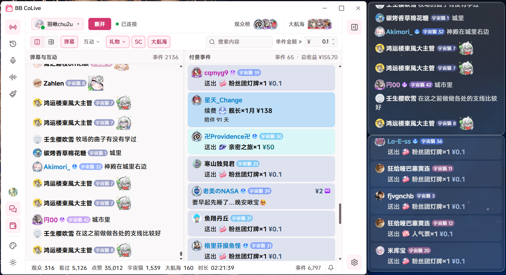
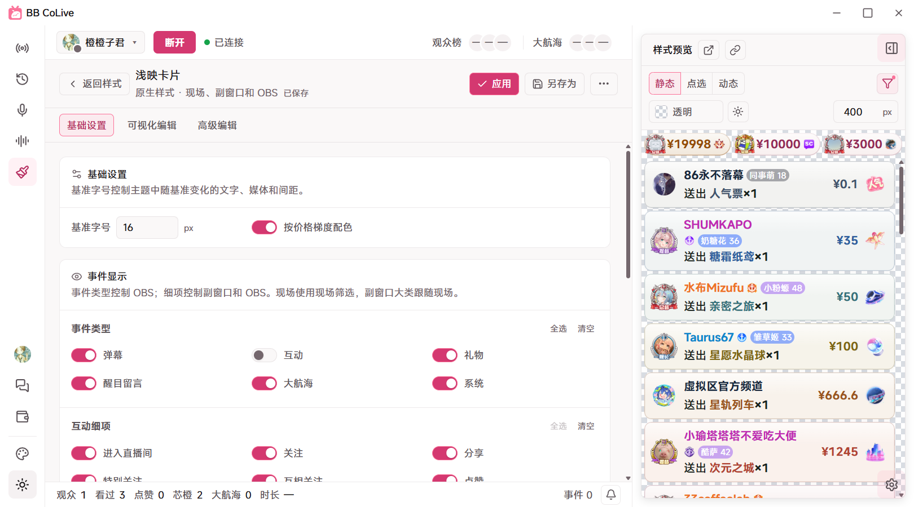

<div align="center">


# BB CoLive

**懂你的直播伙伴。**

面向 B站直播的弹幕展示、语音播报、样式定制与记录回看工具。

[](https://github.com/OrangeChange/bb-colive/releases/tag/v1.1.0)
[](https://gitee.com/orange-chan/bb-colive/releases/tag/v1.1.0)

[](LICENSE)

[功能特性](#功能特性) · [界面预览](#界面预览) · [快速开始](#快速开始) · [使用文档](#使用文档) · [开发与构建](#开发与构建)

</div>

## 功能特性

从直播现场的弹幕阅读，到独立窗口展示、语音播报和下播后的回看，在同一套工具里完成。

| 功能 | 可以做什么 |
| --- | --- |
| **直播现场** | 查看弹幕、互动、礼物、醒目留言、大航海和系统消息；按分类与金额筛选，查看直播间概览、观众榜和大航海榜。 |
| **独立窗口** | 开启弹幕窗与收益窗；收益窗可分为礼物、醒目留言和大航海三个窗口，支持置顶、锁定与鼠标穿透。 |
| **OBS 展示** | 为不同直播间保存浏览器源配置，分别设置主题、缩放与明暗模式，把事件展示到直播画面。 |
| **样式编辑** | 使用三种原生主题，或选择 BLC 原版、BLC 开放版、LAPLACE 兼容样式；支持可视化编辑、CSS、主题导入导出与实时预览。 |
| **声音与特效** | 使用 TTS 朗读事件，为个性播报配置本地提示音，按需开启礼物和大航海特效。 |
| **回看与整理** | 按主播和场次浏览本地档案，检索事件、收藏并添加备注与标签，导出 Excel、CSV 或 JSON。 |
| **界面语言** | 支持简体中文、繁體中文、英文与日文，设置搜索可使用四种语言的关键词；事件内容保持原样。 |

### 让展示适合自己的直播间

- **三种原生主题**：原生默认、浅映卡片、轻语气泡。
- **可视化调整**：编辑文字、身份标记、价格梯度、背景、渐变、装饰图片和头像框，也可以直接编写 CSS。
- **不同输出分别设置**：现场、副窗口和 OBS 可以使用不同主题；副窗口支持统一主题或分别配置。
- **随时预览**：静态、点选与动态预览共用软件实际渲染组件，回看外观独立设置。
- **软件配色**：樱花粉、青瓷绿及自定义配色，支持浅色、深色与跟随系统。

### 直播之后也能继续查阅

回看档案保存在本地，按主播与直播场次组织。可以查找某条弹幕、某位用户的互动或礼物记录，也可以将收藏、备注和标签用于后续整理。

需要从自己的云端记录服务取回历史记录时，可配置 BB EventFetcher，按范围恢复到本地档案。客户端与采集服务独立，具体设置见[云端记录恢复](docs/user-guide.md#恢复云端记录)。

## 界面预览



直播现场与副窗口模式



内置原生样式，拥有完整编辑窗口和可视化自定义空间

## 快速开始

### 查看直播与打开副窗口

1. 打开 BB CoLive，按提示使用 B站扫码登录。
2. 添加主播或输入直播间号，点击 **连接**。
3. 在现场按需选择弹幕、互动与付费事件；通过侧栏按钮打开 **弹幕窗** 和 **收益窗**。
4. 进入 **样式 → 当前使用**，为现场和副窗口选择主题；编辑后点击 **应用**，更新对应输出。
5. 已记录的直播可以在 **回看** 中按主播、场次继续浏览。

### 添加到 OBS

1. 进入 **样式 → OBS 设置**，新建配置。
2. 选择直播间、主题、显示缩放和明暗模式，保存配置。
3. 复制 **OBS 地址**，在 OBS 中添加 **浏览器源** 并粘贴地址。

OBS 输出由本机程序提供，使用期间需保持 BB CoLive 运行。详细说明见[浏览器输出](docs/user-guide.md#添加到-obs)。

### 开启语音播报

在 **语音** 页面选择引擎、配置音色并试听，然后开启播报。支持 Edge 在线、Windows 系统语音、Fish Audio 与自定义 HTTP API；本地提示音在 **个性播报** 中配置。

收听范围及输出设备在 **设置 → 语音与播报 → 声音输出** 中统一管理。详见[语音与个性播报](docs/user-guide.md#语音与个性播报)。

## 使用文档

| 想了解什么 | 文档 |
| --- | --- |
| 切换语言与搜索设置 | [界面语言与设置搜索](docs/user-guide.md#界面语言与设置搜索) |
| 登录、连接与断线重连 | [连接与登录](docs/user-guide.md#连接直播间) |
| 筛选、合并与事件操作 | [现场事件流](docs/user-guide.md#查看现场) |
| 开启、拆分与调整副窗口 | [弹幕窗与收益窗](docs/user-guide.md#开启副窗口) |
| 修改主题、图片与 CSS | [样式与可视化编辑](docs/user-guide.md#修改样式) |
| 身份信息与金额显示 | [事件显示](docs/user-guide.md#编辑主题) |
| 查找历史直播与整理收藏 | [回看与档案](docs/user-guide.md#回看与收藏) · [收藏](docs/user-guide.md#回看与收藏) |
| 导出记录与收益数据 | [数据导出](docs/user-guide.md#备份与导出) |
| 排查连接、声音或显示问题 | [诊断与日志](docs/user-guide.md#如何反馈问题) |

[完整使用指南](docs/user-guide.md) · [开发与维护文档](docs/README.md)

## 常见问题

### 支持哪些系统？

当前正式支持 **Windows 10 / 11 x64**，依赖 WebView2。暂不支持 macOS、Linux。安装版与便携版支持软件内更新，可选择国内或国外下载线路。

### 数据和自定义主题保存在哪里？

| 内容 | 安装版 | 便携版 |
| --- | --- | --- |
| 设置、登录状态、档案与日志 | `%APPDATA%\BB CoLive\` | 程序旁的 `data/` |
| 主题与自定义素材 | 程序旁的 `style/` | 程序旁的 `style/` |

便携版通过程序旁的 `portable.flag` 启用。移动或备份便携版时，保留完整目录，包括 `data/` 和 `style/`。

从旧版 danmu-app 升级至 1.0.0 前，先退出旧版并备份。首次启动会复制旧数据且保留原目录；目标已有数据时不覆盖。迁移与主题保留规则见[升级时怎么保留记录](docs/user-guide.md#升级时怎么保留记录)。

### 隐藏事件会影响记录吗？

现场筛选与档案记录相互独立，隐藏事件不会删除原始记录。回看使用自己的筛选和外观设置，不随现场主题变化。

### 如何提供排查信息？

在 **设置 → 诊断与日志** 中导出最近24小时或完整诊断包。诊断包用于排查问题，回看备份与数据分析请使用档案传输或数据导出功能。详见[诊断与日志](docs/user-guide.md#如何反馈问题)。

## 开发与构建

基于 **Tauri 2 · React 19 · TypeScript · Tailwind CSS · Radix UI**。

开发环境：Windows 10 / 11 x64、Node.js 24、Rust MSVC 工具链、Microsoft C++ Build Tools 和 WebView2；确保 `~/.cargo/bin` 已加入 `PATH`。

```bash
npm ci
npm ci --prefix vendor/blivechat

npm run tauri dev                      # 启动开发环境
npm run build                          # TypeScript 检查与前端构建
npm test                               # Node 测试
npm run tauri -- build --bundles nsis   # 生成 Windows 安装包
```

第二条安装命令为兼容渲染和全量测试准备依赖。浏览器测试使用 Playwright 及本机 Edge 或 Chrome。日常录档使用正式程序，避免开发模式的热更新中断现场状态。

- [开发文档](docs/README.md)：功能约定、架构与维护说明。
- [调试与验收](docs/development/debugging-and-testing.md)：开发入口、运行约束与验证方法。
- [构建与发布](docs/development/build-and-release.md)：安装版、便携版与源码包。
- [当前架构](docs/architecture.md) · [目录职责](docs/development/repository-structure.md)。
- [产品与界面规范](docs/specifications/README.md) · [原生事件样式契约](docs/development/native-event-style-contract.md)。

## 作者与相关项目

<p>
<picture><source media="(prefers-color-scheme: dark)" srcset="docs/images/badges/compatible-label-dark.png" /></picture>
<a href="https://github.com/xfgryujk/blivechat"><picture><source media="(prefers-color-scheme: dark)" srcset="docs/images/badges/blivechat-dark.png" /></picture></a>
<a href="https://chat.laplace.live/"><picture><source media="(prefers-color-scheme: dark)" srcset="docs/images/badges/laplace-dark.png" /></picture></a>
</p>

<p>
<a href="https://react.dev/"><picture><source media="(prefers-color-scheme: dark)" srcset="docs/images/badges/react-dark.png" /></picture></a>
<a href="https://tauri.app/"><picture><source media="(prefers-color-scheme: dark)" srcset="docs/images/badges/tauri-dark.png" /></picture></a>
<a href="https://tailwindcss.com/"><picture><source media="(prefers-color-scheme: dark)" srcset="docs/images/badges/tailwind-dark.png" /></picture></a>
<a href="https://www.radix-ui.com/"><picture><source media="(prefers-color-scheme: dark)" srcset="docs/images/badges/radix-dark.png" /></picture></a>
</p>

<p>
<a href="https://space.bilibili.com/4261481"><picture><source media="(prefers-color-scheme: dark)" srcset="docs/images/badges/bilibili-dark.png" /></picture></a>
<a href="https://afdian.com/a/orangeee"><picture><source media="(prefers-color-scheme: dark)" srcset="docs/images/badges/afdian-dark.png" /></picture></a>
</p>

## 许可

项目自有代码采用 [BB CoLive 软件与源码使用许可协议](LICENSE)，属于**源码可用许可**，不属于 OSI 定义的开源许可。

允许主播和公司用于盈利活动，允许主题及相关服务收费；禁止未经授权收费销售软件原版、修改版或其使用权。具体范围以协议原文为准。

依赖、字体、兼容主题及素材遵循各自授权，详见[第三方许可](THIRD_PARTY_NOTICES.md)。安装版和便携版附带完整离线许可声明。

© 2026 橙橙子君 Orange
