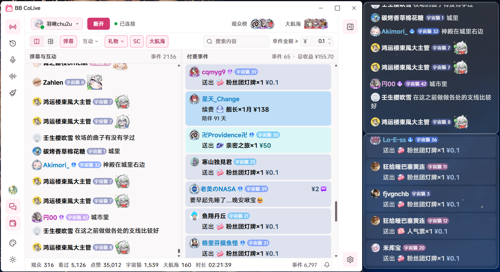
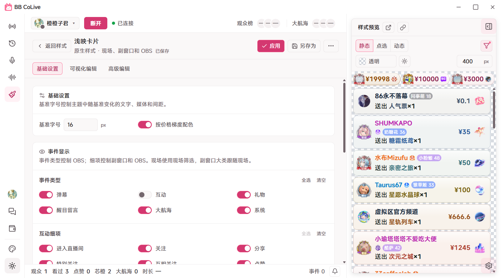

<div align="center">


# BB CoLive

[简体中文](README.md) · [繁體中文](README.zh-Hant.md) · [English](README.en.md) · [日本語](README.ja.md)

**懂你的直播夥伴。**

面向 B站直播的彈幕展示、語音播報、樣式自訂與記錄回看工具。

<a href="https://github.com/OrangeChange/bb-colive/releases/tag/v1.1.0"><picture><source media="(prefers-color-scheme: dark)" srcset="docs/images/badges/github-version-dark.svg" /></picture></a>
<a href="https://gitee.com/orange-chan/bb-colive/releases/tag/v1.1.0"><picture><source media="(prefers-color-scheme: dark)" srcset="docs/images/badges/gitee-version-dark.svg" /></picture></a>
<picture><source media="(prefers-color-scheme: dark)" srcset="docs/images/badges/windows-dark.svg" /></picture>
<a href="LICENSE"><picture><source media="(prefers-color-scheme: dark)" srcset="docs/images/badges/license-dark.svg" /></picture></a>

[功能特色](#功能特色) · [介面預覽](#介面預覽) · [快速開始](#快速開始) · [使用文件](#使用文件) · [開發與建置](#開發與建置)

</div>

> 下載徽章指向已發佈的 1.1.0 版本。本文說明目前主分支；尚未隨安裝檔發佈的更新請見[專案狀態](docs/project-status.md)。

## 功能特色

從直播現場的彈幕閱讀，到獨立視窗展示、語音播報與下播後的回看，在同一套工具內一次完成。

| 功能 | 可以做什麼 |
| --- | --- |
| **直播現場** | 查看彈幕、互動、禮物、醒目留言、大航海與系統訊息；依分類與金額篩選，查看直播間概覽、觀眾榜與大航海榜。 |
| **獨立視窗** | 開啟彈幕視窗與收益視窗；收益視窗可拆分為禮物、醒目留言與大航海三個視窗，支援置頂、鎖定與滑鼠穿透。 |
| **OBS 展示** | 為不同直播間儲存瀏覽器來源設定，分別設定主題、縮放與深淺模式，將事件展示到直播畫面。 |
| **樣式編輯** | 使用三種原生主題，或選擇 BLC 原版、BLC 開放版、LAPLACE 相容樣式；支援視覺化編輯、CSS、主題匯入匯出與即時預覽。 |
| **聲音與特效** | 使用 TTS 朗讀事件，為個性播報設定本機提示音，依需求開啟禮物與大航海特效。 |
| **回看與整理** | 依主播與場次瀏覽本機檔案，搜尋事件、收藏並加上備註與標籤，匯出 Excel、CSV 或 JSON。 |
| **介面語言** | 支援簡體中文、繁體中文、英文與日文，設定搜尋可使用四種語言的關鍵字；事件內容保持原樣。 |

### 讓展示適合自己的直播間

- **三種原生主題**：原生預設、淺映卡片、輕語氣泡。
- **視覺化調整**：編輯文字、身分標記、價格梯度與漸層；獨立設定圖片背景、裝飾圖、圖片邊框與頭像框，支援元件及事件效果預覽，也可直接編寫 CSS。
- **不同輸出分別設定**：現場、副視窗與 OBS 可使用不同主題；副視窗支援統一主題或分別設定。
- **隨時預覽**：靜態、點選與動態預覽共用軟體實際渲染元件，回看外觀獨立設定。
- **軟體配色**：櫻花粉、青瓷綠及自訂配色，支援淺色、深色與跟隨系統。

### 直播之後也能繼續查閱

回看檔案儲存在本機，依主播與直播場次整理。可搜尋特定彈幕、某位使用者的互動或禮物記錄，也可將收藏、備註與標籤用於後續整理。

需要從自己的雲端記錄服務取回歷史記錄時，可設定 BB EventFetcher，依範圍還原至本機檔案。用戶端與擷取服務彼此獨立，詳細設定請見[雲端記錄恢復](docs/user-guide.md#恢复云端记录)。

## 介面預覽



直播現場與副視窗模式



內建原生樣式，具備完整編輯視窗與視覺化自訂空間

## 快速開始

### 查看直播與開啟副視窗

1. 開啟 BB CoLive，依提示使用 B站掃碼登入。
2. 新增主播或輸入直播間號，點擊 **連線**。
3. 在現場依需求選擇彈幕、互動與付費事件；透過側邊欄按鈕開啟 **彈幕視窗** 與 **收益視窗**。
4. 進入 **樣式 → 目前使用**，為現場與副視窗選擇主題；編輯後點擊 **套用**，更新對應輸出。
5. 已記錄的直播可在 **回看** 中依主播、場次繼續瀏覽。

### 新增至 OBS

1. 進入 **樣式 → OBS 設定**，新增設定檔。
2. 選擇直播間、主題、顯示縮放與深淺模式並儲存設定。
3. 複製 **OBS 位址**，在 OBS 中新增 **瀏覽器來源** 並貼上位址。

OBS 輸出由本機程式提供，使用期間需保持 BB CoLive 執行。詳細說明請見[瀏覽器輸出](docs/user-guide.md#添加到-obs)。

### 開啟語音播報

在 **語音** 頁面選擇引擎、設定音色並試聽，然後開啟播報。支援 Edge 線上、Windows 系統語音、Fish Audio 與自訂 HTTP API；本機提示音可在 **個性播報** 中設定。

收聽範圍與輸出裝置在 **設定 → 語音與播報 → 聲音輸出** 中統一管理。詳見[語音與個性播報](docs/user-guide.md#语音与个性播报)。

## 使用文件

| 想了解什麼 | 文件 |
| --- | --- |
| 切換語言與搜尋設定 | [介面語言與設定搜尋](docs/user-guide.md#界面语言与设置搜索) |
| 登入、連線與斷線重連 | [連線與登入](docs/user-guide.md#连接直播间) |
| 篩選、合併與事件操作 | [現場事件流](docs/user-guide.md#查看现场) |
| 開啟、拆分與調整副視窗 | [彈幕視窗與收益視窗](docs/user-guide.md#开启副窗口) |
| 修改主題、圖片與 CSS | [樣式與視覺化編輯](docs/user-guide.md#修改样式) |
| 身分資訊與金額顯示 | [事件顯示](docs/user-guide.md#编辑主题) |
| 搜尋歷史直播與整理收藏 | [回看與檔案](docs/user-guide.md#回看与收藏) · [收藏](docs/user-guide.md#回看与收藏) |
| 匯出記錄與收益資料 | [資料匯出](docs/user-guide.md#备份与导出) |
| 排查連線、聲音或顯示問題 | [診斷與日誌](docs/user-guide.md#如何反馈问题) |

[完整使用指南](docs/user-guide.md) · [開發與維護文件](docs/README.md)

## 常見問題

### 支援哪些系統？

目前正式支援 **Windows 10 / 11 x64**，需具備 WebView2。暫不支援 macOS、Linux。安裝版與可攜版皆支援軟體內更新，可選擇中國大陸或海外下載線路。

### 資料與自訂主題儲存在哪裡？

| 內容 | 安裝版 | 可攜版 |
| --- | --- | --- |
| 設定、登入狀態、檔案與日誌 | `%APPDATA%\BB CoLive\` | 程式旁的 `data/` |
| 主題與自訂素材 | 程式旁的 `style/` | 程式旁的 `style/` |

可攜版透過程式旁的 `portable.flag` 啟用。移動或備份可攜版時，請保留完整目錄，包含 `data/` 與 `style/`。

從舊版 danmu-app 升級至 1.0.0 前，請先結束舊版並備份。首次啟動時會複製舊資料並保留原目錄；若目標已有資料則不會覆蓋。遷移與主題保留規則請見[升級時怎麼保留記錄](docs/user-guide.md#升级时怎么保留记录)。

### 隱藏事件會影響記錄嗎？

現場篩選與檔案記錄彼此獨立，隱藏事件不會刪除原始記錄。回看使用獨立的篩選與外觀設定，不隨現場主題變動。

### 如何提供排查資訊？

在 **設定 → 診斷與日誌** 中匯出最近 24 小時或完整診斷包。診斷包用於排查問題，回看備份與資料分析請使用檔案傳輸或資料匯出功能。詳見[診斷與日誌](docs/user-guide.md#如何反馈问题)。

## 開發與建置

基於 **Tauri 2 · React 19 · TypeScript · Tailwind CSS · shadcn/ui · Radix UI**。

開發環境：Windows 10 / 11 x64、Node.js 24、Rust MSVC 工具鏈、Microsoft C++ Build Tools 與 WebView2；請確認 `~/.cargo/bin` 已加入 `PATH`。

```bash
npm ci
npm ci --prefix vendor/blivechat

npm run tauri dev                      # 啟動開發環境
npm run build                          # TypeScript 檢查與前端建置
npm test                               # Node 測試
npm run tauri -- build --bundles nsis   # 產生 Windows 安裝檔
```

第二條安裝指令用於準備相容渲染與全量測試所需的相依套件。瀏覽器測試使用 Playwright 及本機 Edge 或 Chrome。日常錄製記錄請使用正式版本，避免開發模式的熱重載中斷現場狀態。

- [開發文件](docs/README.md)：功能約定、架構與維護說明。
- [除錯與驗收](docs/development/debugging-and-testing.md)：開發入口、執行限制與驗證方法。
- [介面元件](src/components/shadcn/README.md)：shadcn/ui 整合、共用控制項與樣式職責。
- [多語言適配](docs/development/interface-localization.md)：翻譯邊界、用語確認與驗收要求。
- [建置與發佈](docs/development/build-and-release.md)：安裝版、可攜版與原始碼套件。
- [目前架構](docs/architecture.md) · [目錄職責](docs/development/repository-structure.md)。
- [產品與介面規範](docs/specifications/README.md) · [原生事件樣式契約](docs/development/native-event-style-contract.md)。

## 作者與相關專案

<p>
<picture><source media="(prefers-color-scheme: dark)" srcset="docs/images/badges/compatible-label-dark.png" /></picture>
<a href="https://github.com/xfgryujk/blivechat"><picture><source media="(prefers-color-scheme: dark)" srcset="docs/images/badges/blivechat-dark.png" /></picture></a>
<a href="https://chat.laplace.live/"><picture><source media="(prefers-color-scheme: dark)" srcset="docs/images/badges/laplace-dark.png" /></picture></a>
</p>

<p>
<a href="https://react.dev/"><picture><source media="(prefers-color-scheme: dark)" srcset="docs/images/badges/react-dark.png" /></picture></a>
<a href="https://tauri.app/"><picture><source media="(prefers-color-scheme: dark)" srcset="docs/images/badges/tauri-dark.png" /></picture></a>
<a href="https://tailwindcss.com/"><picture><source media="(prefers-color-scheme: dark)" srcset="docs/images/badges/tailwind-dark.png" /></picture></a>
<a href="https://ui.shadcn.com/"><picture><source media="(prefers-color-scheme: dark)" srcset="docs/images/badges/shadcn-dark.svg" /></picture></a>
<a href="https://www.radix-ui.com/"><picture><source media="(prefers-color-scheme: dark)" srcset="docs/images/badges/radix-dark.png" /></picture></a>
</p>

<p>
<a href="https://space.bilibili.com/4261481"><picture><source media="(prefers-color-scheme: dark)" srcset="docs/images/badges/bilibili-dark.png" /></picture></a>
<a href="https://afdian.com/a/orangeee"><picture><source media="(prefers-color-scheme: dark)" srcset="docs/images/badges/afdian-dark.png" /></picture></a>
</p>

## 授權條款

專案自有程式碼採用 [BB CoLive 軟體與原始碼使用授權協議](LICENSE)，屬於**原始碼可用授權**，不屬於 OSI 定義的開源授權。

允許主播與企業用於營利活動，允許主題及相關服務收費；禁止未經授權收費販售軟體原版、修改版或其使用權。具體範圍以協議原文為準。

相依套件、字型、相容主題及素材遵循各自授權，詳見[第三方授權聲明](THIRD_PARTY_NOTICES.md)。安裝版與可攜版均附帶完整離線授權聲明。

© 2026 橙橙子君 Orange
